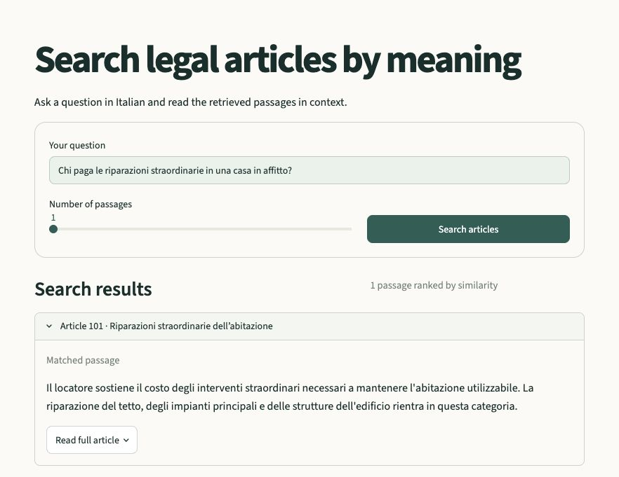
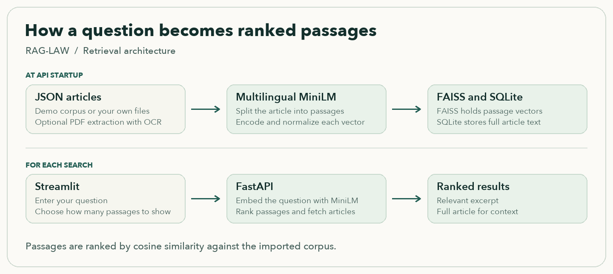

# RAG-LAW

**Search Italian legal documents by meaning.** Turn a question into ranked passages, then open the full article for context.

RAG-LAW combines the original retrieval pipeline with the Streamlit interface previously developed in RAG-LAW-UI. The backend uses a multilingual MiniLM encoder, FAISS for passage search and SQLite for complete article text.

<p align="center">
  
</p>

*The screenshot shows a real query against the included fictional corpus. The results are retrieved excerpts.*

## Run the demo

Use **Python 3.11** on ARM64 or x86-64. The first start downloads the tokenizer and a quantized ONNX export of [MiniLM](https://huggingface.co/sentence-transformers/paraphrase-multilingual-MiniLM-L12-v2) from a pinned revision (about 128 MB). The example corpus is included and the app needs no API key.

```bash
python3.11 -m venv .venv
source .venv/bin/activate
python -m pip install -r requirements.txt
python -m uvicorn api.main:app --port 8000
```

Activate the same virtual environment in a second terminal and start the UI.

```bash
python -m streamlit run ui/main.py
```

Open [Streamlit](http://localhost:8501) and submit the pre-filled question about repairs in a rented home. The top result should be **Article 101 · Riparazioni straordinarie dell’abitazione**. Open **Read full article** to see the rest of the provision. The [API documentation](http://127.0.0.1:8000/docs) shows the request and response schemas.

With Docker Compose, run `docker compose up --build` and open the same Streamlit URL. The API image caches the model during the build. The initial build needs internet access.

## How search works



At startup, the API splits articles into overlapping passages, embeds them and builds an in-memory FAISS index. SQLite stores each full article. On a search request, the same encoder embeds the question, FAISS ranks the passages by cosine similarity and SQLite supplies the article text for each hit. Each API process loads the model and index once.

```bash
curl -s http://127.0.0.1:8000/search \
  -H 'Content-Type: application/json' \
  -d '{"query":"Chi paga le riparazioni straordinarie in una casa in affitto?","top_k":3}'
```

Use `GET /health` to check readiness and see the indexed article and passage counts. Run `python predict.py "query" --top-k 3` for a command-line API client, or `python main.py "query"` to search locally without the server.

## Use your own corpus

The demo ships with [eight fictional Italian articles](examples/italian_demo.json). For another corpus, set `RAGLAW_CORPUS_PATH` when starting the API. Supply a UTF-8 JSON array whose records contain `article_number` and `text`, with an optional `title`. The following commands convert a PDF with numbered Italian articles after you install Poppler and Tesseract on your system.

```bash
python -m pip install -r requirements-ocr.txt
python -m scripts.article_splitter path/to/code.pdf --output data/articles.json
RAGLAW_CORPUS_PATH=data/articles.json python -m uvicorn api.main:app --port 8000
```

Review the extracted text before indexing it. The parser expects headings such as `Art. 101` and OCR quality depends on the document layout. Use source material you have permission to process and distribute.

## Cloud setup and scope

The original web prototype called a FastAPI container on Google Cloud Run. For a new deployment, build the `api` Docker target, which serves on port 8080. Set `RAGLAW_API_URL` on the Streamlit host to the API's base URL. For an offline model copy, set `RAGLAW_MODEL_PATH` to a directory with `tokenizer.json` and the ONNX file for your CPU from the pinned model revision.

The demo indexes a small corpus at startup and runs exact FAISS search on CPU. A larger deployment would need measured startup time, memory and concurrent-query latency. On a growing corpus, prebuilding the index would avoid repeating embedding work on each instance. Retrieval quality has yet to be measured against a labelled legal-search benchmark.

The included corpus is fictional and the project is for demonstration and research.

## Repository guide

| Path | What it contains |
| --- | --- |
| `ui/` | Streamlit search interface |
| `api/` | FastAPI search and readiness routes |
| `modules/` | MiniLM/FAISS retrieval, SQLite access and PDF utilities |
| `examples/` | Included Italian demo corpus |
| `scripts/` | PDF-to-JSON extraction |
| `Dockerfile`, `compose.yaml` | Separate build targets and local orchestration |

Code released under the [MIT License](LICENSE).
